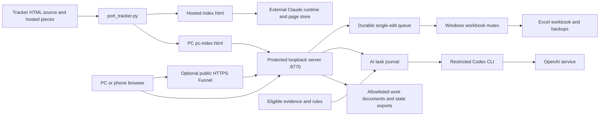

# Architecture

Job Search HQ uses an Excel workbook as the tracker source of truth. A generated browser page reads it through a protected loopback server. Optional analysis and drafting run through a separate task journal and Codex CLI. The application never applies for jobs or sends messages.

## Components and page builds

`tools/tracker/index.html` supplies the core views, styles, and screen behavior. `tools/hq-dashboard/port_tracker.py` combines it with `hosted/` fragments. Its default `claude` backend writes `tools/hq-dashboard/index.html`, using `data.js` and `tools.js` with external Claude page-store/sample/download capabilities. This repository does not ship that runtime or its synchronization service. The hosted build includes a JSZip CDN script; do not treat it as the PC security model.

The `pc` backend writes `tools/hq-dashboard/pc-index.html`. It substitutes `pc-data.js`, adds `pc-tools.js` and `pc.css`, removes the CDN dependency, and connects to same-origin PC APIs. Both outputs are ignored by Git. Exact string and pattern replacements deliberately fail when source structure drifts. The entire block between the tracker `data` and `writes` markers is replaced; view functions needed after the build must live outside it.

`tools/hq-dashboard/server.py` handles authentication, allowlisted routes, bounded requests, workbook access, and component loading. It reads the generated PC file on page requests. `tools/tracker/server.py` contains workbook parsing/writing and a separate plain loopback tracker on port 8765. That plain server is not a substitute for protected remote hosting. Full HQ startup takes a Windows-only instance lock; it cannot run on macOS/Linux as written.

## State and persistence

| Location | Contents |
| --- | --- |
| Repository `work/` | Default `applications-tracker.xlsx`, `.tracker-backups/`, existing `CV_*.docx`, `CL_*.docx`, `report-*.md`, and optional scan logs. Ignored by Git. |
| `evidence/`, `rules.md` | Local facts and drafting rules. Only fictional `*-example-*.md` evidence is tracked. Missing rules fall back to tracked `rules.example.md`. |
| `%LOCALAPPDATA%\JobSearchHQ` by default | Salted scrypt password hash, persistent login throttle, pending write journal, career task journal, uploaded images/task files, generated Word exports, and optional startup settings/logs. `--state` must be outside the repository. |
| Browser | Session cookie; localStorage for theme/filter preferences, an unfinished posting form, and sentiment. Photos remain in memory until submitted; submitted photos are stored with tasks. |

`write_queue.py` accepts one unresolved workbook edit at a time and deduplicates request IDs. Before writing, the server checks the workbook version and expected row identity under a Windows mutex. Excel or another writer holding the file leaves the edit waiting; retries run every five seconds. A changed workbook becomes a conflict rather than a silent merge. An interrupted applying operation becomes `needs_check`; a human must inspect the workbook before dismissal or repetition.

The writer saves a neighboring temporary workbook, reopens it to check sheet names, makes a daily backup, and atomically replaces the original. It retains seven backup files. These backups do not cover evidence or state. The mutex coordinates cooperating writers only; it is not a general lock on Excel reading.

## Trust boundaries

The protected server binds only to `127.0.0.1` (default port 8770). Optional Funnel terminates public HTTPS and forwards to that listener. Funnel makes sign-in public; it does not authenticate application users. All authenticated visitors share one password and the same read/write/AI authority.

Requests require an exact Host; POSTs also require the configured Origin. Cookies are Secure, HttpOnly, and SameSite=Strict. Sessions last 12 hours in memory; the account-wide five-failure/15-minute throttle persists on disk. Local unlock clears it. A same-origin content security policy, route allowlists, document path/size checks, request limits, and formula/text checks constrain inputs. They do not protect against a compromised local account or replace private backups. Loopback HTTP cookie behavior needs browser verification.

Posting text, photos, and sentiment are untrusted input. `ai_tasks.py` builds typed prompts from eligible evidence and rules and runs one task at a time. The CLI uses ChatGPT authentication, a read-only sandbox, disabled shell/plugins/hooks/web search, and ephemeral execution. API-key environment variables are removed from the child. Rules, eligible evidence, posting data, photos, and sentiment still leave the PC for OpenAI. CLI compatibility, usage, and per-task cost require installation-specific validation.

## Evidence-first drafting and limits

Only eligible `E-*.md` entries marked verified/stated and public-safe, with usable CV-ready wording, enter the prompt. This filters the owner's labels; it does not verify those labels or facts. Draft validation checks cited-ID eligibility and the presence of listed claim strings. It does not establish complete factual-claim coverage or whether evidence supports a claim. Offline tests explicitly demonstrate acceptance of unlisted factual prose. Every draft needs human truth review.

Running AI tasks become interrupted after restart and are not blindly rerun; already queued tasks can still run. Word export code removes defined note markers and keeps results as drafts in state. Existing document listings read `work/` separately; exports are not automatically enrolled there. CV fitting uses Windows Arial metrics and deletes lines/sentences without rewording; actual Word/Pages pagination still needs visual review. On-demand PC search and a daily scan runner are not supplied.

## Test strategy

Windows CI uses Python 3.12, installs requirements plus Playwright/WebKit, builds PC HTML, and runs `test_ai_tasks.py`, `test_cv_onepage.py`, and `test_pc_server.py`. These cover fake-provider task validation, claim-map limits, document conversion/layout invariants, queue recovery, authentication, Host/Origin checks, request bounds, workbook conflicts, downloads, and browser flows. Browser geometry is checked at four widths including 375 px; local HTTPS tests require a fixed Git for Windows OpenSSL executable. CV fitting loads fixed Windows font paths.

No suite requires a live model or private career data. `check_codex_worker.py` is a separate live, usage-consuming check. Tests do not establish public tunnel behavior, boot recovery, real-device usability, or actual Word rendering. Runtime checks for this documentation change are **Unverified**; see [SETUP Known gaps](../SETUP.md#known-gaps).
