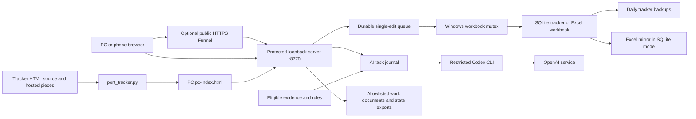

# Architecture

Job Search HQ uses SQLite as the tracker source of truth when a database exists beside the workbook, and otherwise uses Excel. A generated browser page reads it through a protected loopback server. Optional analysis and drafting run through a separate task journal and Codex CLI. The application never applies for jobs or sends messages.

## Components and page builds

`tools/tracker/index.html` supplies the core views, styles, and screen behavior. `tools/hq-dashboard/port_tracker.py` combines it with `hosted/` fragments and builds only the main PC page, for both desktop and phone. `--backend pc` remains accepted; any other backend is refused.

The build writes `tools/hq-dashboard/pc-index.html`. It substitutes `pc-data.js`, adds `pc-tools.js` and `pc.css`, removes the CDN dependency, and connects to same-origin PC APIs. The generated output is ignored by Git. Exact string and pattern replacements deliberately fail when source structure drifts. The entire block between the tracker `data` and `writes` markers is replaced; view functions needed after the build must live outside it.

`tools/tracker/stages.json` is the only stage definition: Tracked, Review, Apply, Skipped, Applied, Interview, Offer, Rejected. The tracker server and page builder inline this file into one HTML placeholder. Python consumers use `stages.py`; new leads use its `NEW_ROW`. Every current status has one bucket, with Other for unknown values. Offer is green, Rejected red, and the remaining stages gray. The server accepts Rejected only from Applied, Interview, Offer or itself. The board also hides Skipped as a move target after applying.

With the server stopped, preview `python -I tools/tracker/migrate_stages.py --workbook work/applications-tracker.xlsx --dry-run`, review counts, then use `--apply`. The migration reads the neighboring database when present, otherwise Excel, and preserves contacts, other sheets and archived jobs. Apply creates a `logs/*-before-stages-*` backup, checks row counts, records database moves as `stages-01`, and rebuilds the mirror. Rebuild the PC page and restart the server afterward.

`tools/hq-dashboard/server.py` handles authentication, allowlisted routes, bounded requests, workbook access, and component loading. It reads the generated PC file on page requests. `tools/tracker/server.py` contains workbook parsing/writing and a separate plain loopback tracker on port 8765. That plain server is not a substitute for protected remote hosting. Full HQ startup takes a Windows-only instance lock; it cannot run on macOS/Linux as written.

## State and persistence

`tools/tracker/store.py` preserves ordered sheet layouts, typed rows and original row numbers in a neighboring `.sqlite3` file; `migrate_to_sqlite.py` offers a disk-free dry run and a backed-up, count-checked migration. The server selects storage on each call, uses database revisions for caching, and commits row changes and status history together. In SQLite mode Excel becomes a read-only mirror rebuilt through a verified temporary file: an Excel lock defers rebuilding until a later write, external Excel edits are copied into `logs/` with a warning, and a missing mirror is recreated. Both modes make daily pre-write backups in `.tracker-backups`, retaining seven files for each type. Workbook modification-time conflicts apply only in Excel mode; the writer mutex still coordinates both modes.

### Keep your data outside the app folder (optional)

Put the app in a folder named `app` inside your data folder, then create an empty `.job-search-hq-data` file in the data folder, or set `JOB_SEARCH_HQ_DATA` to that folder. Your `settings.json`, `rules.md`, `work/` and `evidence/` then live in the data folder; bundled defaults and tools stay in the app folder.

`hq_settings.data_root()` resolves private data from `JOB_SEARCH_HQ_DATA`, a `.job-search-hq-data` marker above the app, or the app folder; bundled files always use `app_root()`.

`tools/hq-dashboard/daily_search.py --output today.json` reads the data folder's `profile.json` (or `--profile P`) and its public boards into a SQLite backlog (default `work/search-backlog.sqlite3` in the data folder) and a new JSON landing set; `--backlog B` overrides the backlog path and `--mark-landed` records a successful landing. The Search tab uses the same Greenhouse, Lever, Ashby and Workday board adapters and profile path. The command does not schedule itself or import the landing set into the tracker.

`tools/tracker/land_search.py --snapshot today.json` previews landing into the standing `Daily search` sheet; `--apply` commits rows and posting links together in the SQLite tracker, then marks linked jobs landed in the backlog and refreshes the Excel mirror. It validates the whole snapshot first, backs up the database before writing, and safely retries known postings without adding copies; `--tracker` and `--backlog` override the data folder's `work` paths.

| Location | Contents |
| --- | --- |
| Repository `work/` | Default `applications-tracker.sqlite3` when migrated, `applications-tracker.xlsx`, `.tracker-backups/`, existing `CV_*.docx`, `CL_*.docx`, `report-*.md`, and optional scan logs. Ignored by Git. |
| `evidence/`, `rules.md` | Local facts and drafting rules. Only fictional `*-example-*.md` evidence is tracked. Missing rules fall back to tracked `rules.example.md`. |
| `%LOCALAPPDATA%\JobSearchHQ` by default | Salted scrypt password hash, persistent login throttle, pending write journal, career task journal, uploaded images/task files, generated Word exports, and optional startup settings/logs. `--state` must be outside the repository. |
| Browser | Session cookie; localStorage for theme/filter preferences, an unfinished posting form, and sentiment. Photos remain in memory until submitted; submitted photos are stored with tasks. |

`write_queue.py` accepts one unresolved tracker edit at a time and deduplicates request IDs. Before writing, the server checks the tracker version and expected row identity under a Windows mutex. In Excel mode, Excel or another writer holding the file leaves the edit waiting; retries run every five seconds. A changed tracker version becomes a conflict rather than a silent merge. An interrupted applying operation becomes `needs_check`; a human must inspect the tracker before dismissal or repetition.

In Excel mode the writer saves a neighboring temporary workbook, reopens it to check sheet names, makes a daily backup, and atomically replaces the original. It retains seven backup files. These backups do not cover evidence or state. The mutex coordinates cooperating writers only; it is not a general lock on Excel reading.

## Trust boundaries

The protected server binds only to `127.0.0.1` (default port 8770). Optional Funnel terminates public HTTPS and forwards to that listener. Funnel makes sign-in public; it does not authenticate application users. All authenticated visitors share one password and the same read/write/AI authority.

Requests require an exact Host; POSTs also require the configured Origin. Cookies are Secure, HttpOnly, and SameSite=Strict. Sessions last 12 hours in memory; the account-wide five-failure/15-minute throttle persists on disk. Local unlock clears it. A same-origin content security policy, route allowlists, document path/size checks, request limits, and formula/text checks constrain inputs. They do not protect against a compromised local account or replace private backups. Loopback HTTP cookie behavior needs browser verification.

Posting text, photos, and sentiment are untrusted input. `ai_tasks.py` builds typed prompts from eligible evidence and rules and runs one task at a time. The CLI uses ChatGPT authentication, a read-only sandbox, disabled shell/plugins/hooks/web search, and ephemeral execution. API-key environment variables are removed from the child. Rules, eligible evidence, posting data, photos, and sentiment still leave the PC for OpenAI. CLI compatibility, usage, and per-task cost require installation-specific validation.

## Evidence-first drafting and limits

Only eligible `E-*.md` entries marked verified/stated and public-safe, with usable CV-ready wording, enter the prompt. Optional `- role: Title | Company | Dates` lines supply job headings alongside the CV-ready wording. Optional `- skills: SQL, Reporting` lines supply comma-separated skill names (1 to 40 characters each, without sentence punctuation; letters, numbers, spaces, underscores, plus, hash, slash and hyphen are accepted). Invalid role or skills lines put the entry in `needs_fixing`. Entries without these lines remain usable. This filters the owner's labels; it does not verify those labels or facts.

For CVs, `requirement_list(record)` reads the saved posting requirements. Eligible entries are sent in descending relevance order: must/nice weights 2/1 times strong/partial/gap weights 2/1/0, summed per cited entry, with each entry's three highest-weight supported requirements. Old records have zero scores. The prompt asks for a headline and a targeted 2-3 sentence Summary; each has summary claims. Listed bullet claims must appear word for word in their cited CV-ready text or roles. Summary claims check numbers, capitalized words except the first word of each sentence, and bank skill names against the cited text, roles and skills. The strict CLI schema requires `kind` (`bullet` or `summary`); older results without it still mean bullet. These token checks do not establish semantic truth or complete factual-claim coverage. Offline tests explicitly demonstrate acceptance of unlisted factual prose. Every draft needs human truth review.

After validation and before the site adds the name/contact line, code stably sorts bullets inside each `###` role by their cited entry's relevance, without changing wording or dropping bullets. Code replaces any AI Skills section using only cited entries' skills, deduplicated without regard to case in bank order. `cv_skill_groups` defines group order and membership; unmatched skills form the final Other group. Within each group, whole-word posting mentions come first. Skills goes before Education or at the end, and is omitted when no skills are available. `cv_ai_role_words` matches whole words in the title or must requirements; for those roles, Projects moves before Experience. The 520-word prompt and 600-word hard limit remain, including a check after adding skills. These settings are server-side only. The site adds `owner_contact` when set, as before.
`cv_fixed_sections` (default `[]`) appends sections in configured order after Skills: each item has `name`, `entries` (eligible E-### IDs), and `from` (`text` copies each entry's CV-ready text exactly; `skills` joins their skills with commas); matching AI sections are replaced, empty sections are omitted, used entries and exact lines join the evidence map, their skills are excluded from general Skills, and the 600-word hard limit still applies.

Running AI tasks become interrupted after restart and are not blindly rerun; already queued tasks can still run. Word export code removes defined note markers and keeps results as drafts in state. Existing document listings read `work/` separately; exports are not automatically enrolled there. CV fitting uses Windows Arial metrics and deletes lines/sentences without rewording; actual Word/Pages pagination still needs visual review. On-demand PC search and the daily search command are available. No daily scheduler is supplied.

## Test strategy

Windows CI uses Python 3.12, installs requirements plus Playwright/WebKit, builds PC HTML, and runs the suites listed in the [README](../README.md#tests). These cover fake-provider task validation, claim-map limits, document conversion/layout invariants, queue recovery, authentication, Host/Origin checks, request bounds, workbook conflicts, downloads, and browser flows. Browser geometry is checked at four widths including 375 px; local HTTPS tests require a fixed Git for Windows OpenSSL executable. CV fitting loads fixed Windows font paths.

No suite requires a live model or private career data. `check_codex_worker.py` is a separate live, usage-consuming check. Tests do not establish public tunnel behavior, boot recovery, real-device usability, or actual Word rendering. Runtime checks for this documentation change are **Unverified**; see [SETUP Known gaps](../SETUP.md#known-gaps).
